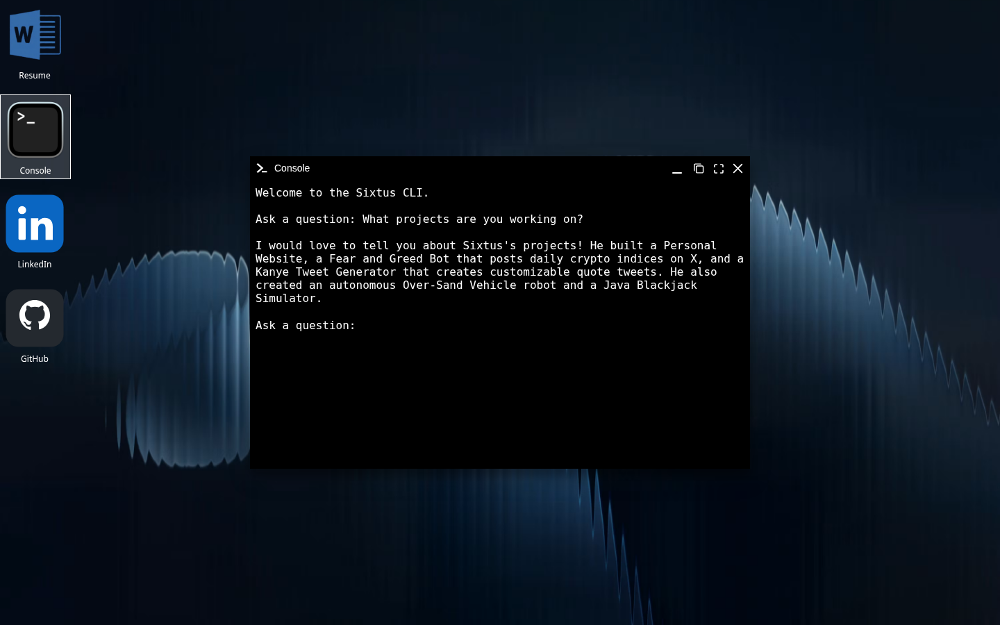
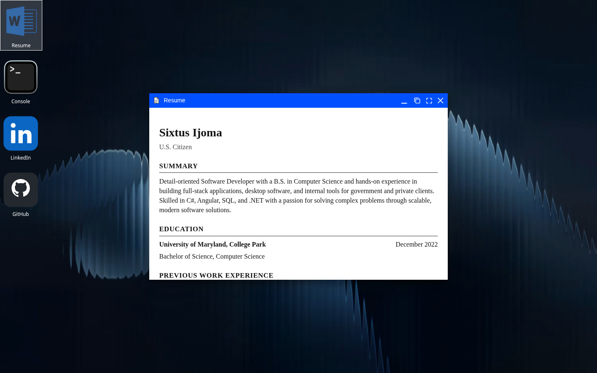
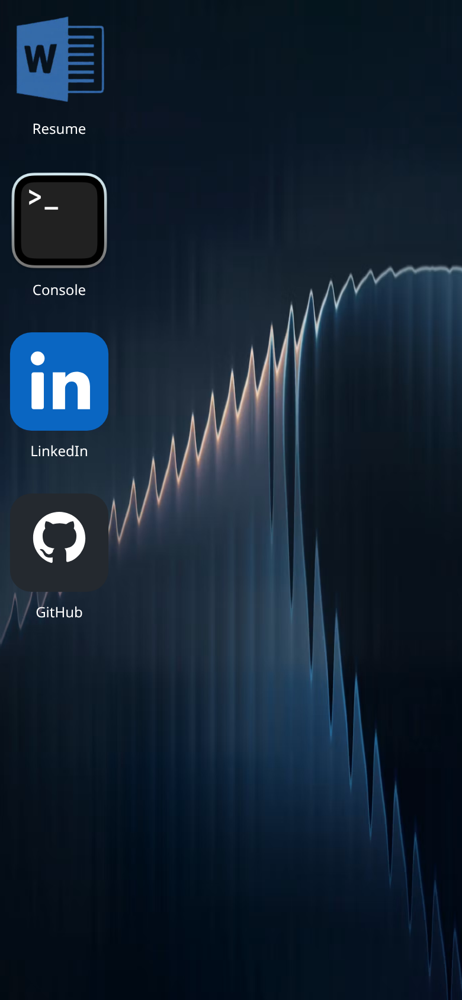
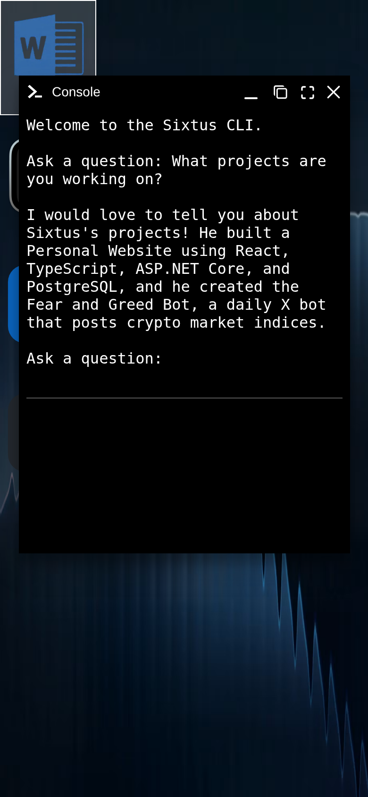
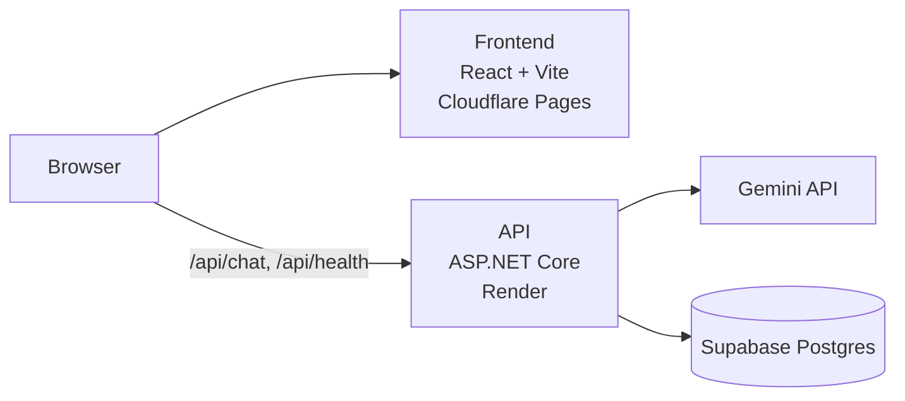

# sixtus.dev

My personal site, built to look like a desktop. Windows open, drag and resize like a real OS, and a small console answers questions about me.

**Live site: [sixtus.dev](https://sixtus.dev)**


A higher-quality version of the demo is available as an [MP4](docs/media/demo.mp4).

## Screenshots

<table>
  <tr>
    <td width="50%"></td>
    <td width="50%"></td>
  </tr>
  <tr>
    <td align="center">Home screen</td>
    <td align="center">Console answering a question</td>
  </tr>
  <tr>
    <td width="50%"></td>
    <td width="50%" align="center">
      
      
    </td>
  </tr>
  <tr>
    <td align="center">Resume window</td>
    <td align="center">On a phone</td>
  </tr>
</table>

## Features

- **Desktop layout.** Resume, Console, LinkedIn and GitHub icons sit on a desktop. Resume and Console open as [WinBox](https://github.com/nextapps-de/winbox) windows you can drag, resize, minimize and maximize; LinkedIn and GitHub open in a new tab.
- **Sixtus CLI.** The console takes plain-English questions and answers them with Gemini, using only a profile the backend holds. Follow-up questions keep the conversation's context.
- **Resume window.** The resume is a static HTML page shown inside a window.
- **Works on phones.** Windows resize to fit small screens.
- **Cold-start handling.** The page pings the backend once on load so it starts waking up early. If an answer takes more than 5 seconds, the console says the server is waking up.
- **Question logging.** Each question and answer is logged to Postgres with a salted hash of the visitor's IP, not the IP itself.

## Tech stack

| Part | Tech |
| --- | --- |
| Frontend | React 19, TypeScript, Vite, WinBox |
| Backend | ASP.NET Core minimal API (.NET 10) |
| AI | Google Gemini |
| Database | Supabase Postgres via Entity Framework Core (Npgsql) |
| Hosting | Cloudflare Pages (frontend), Render free tier in Docker (backend) |

It's mostly written by hand, with some AI assistance.

## Architecture



The browser loads the static frontend from Cloudflare Pages and calls the backend directly. The backend builds a system prompt from the profile, sends the question to Gemini and logs the exchange to Postgres.

```
frontend/   React + TypeScript app (Vite)
backend/    ASP.NET Core API, EF Core models and migrations, Dockerfile
render.yaml Render Blueprint for the backend
DEPLOY.md   Hosting notes
docs/media/ README screenshots and demo
```

## Running locally

You need the .NET 10 SDK and Node.js 20.19+ or 22.12+.

```sh
cd backend
dotnet run        # http://localhost:5035

cd frontend
npm install
npm run dev       # http://localhost:5173, proxies /api to the backend
```

The backend reads these settings from configuration (environment variables work). It exits at startup and names any that are missing.

| Setting | What it's for |
| --- | --- |
| `GEMINI_API_KEY` | API key for Gemini, which answers console questions |
| `SUPABASE_DB_CONNECTION` | Npgsql connection string for the Postgres database that stores chat logs |
| `IP_HASH_SALT` | Secret salt used to hash visitor IPs before they're logged |
| `PROFILE_JSON` | The profile the console answers from (same shape as [`backend/profile.example.json`](backend/profile.example.json)) |
| `BIRTH_DATE` | Date of birth in `yyyy-MM-dd`, used to give the console my current age |
| `CORS_ALLOWED_ORIGINS` | Optional. Comma-separated origins allowed to call the API; defaults to the production domains |

On the frontend, `VITE_API_BASE_URL` sets the backend's public origin at build time. Leave it unset locally and the app calls `/api` on its own origin, which the Vite dev server proxies to `localhost:5035`.

## Deployment

- **Frontend:** Cloudflare Pages, root directory `frontend`, build command `npm run build`, output `dist`. Set `VITE_API_BASE_URL` to the backend URL and `NODE_VERSION` to `22`.
- **Backend:** Render free web service built from `backend/Dockerfile` (or the [`render.yaml`](render.yaml) Blueprint), health check `/api/health`. The free instance sleeps after about 15 minutes idle and can take up to a minute to wake.
- **Database:** Supabase Postgres. Migrations are not applied on startup; apply them by hand before deploying code that needs them.
- **Keepalive:** a scheduled GitHub Actions workflow ([`.github/workflows/supabase-keepalive.yml`](.github/workflows/supabase-keepalive.yml)) pings Supabase twice a week so the free project isn't paused.

See [DEPLOY.md](DEPLOY.md) for the full settings, migrations, visitor IP handling and running the container locally.

## License

[MIT](LICENSE)
